# Regra A0: prints para aprovação (T-0053)

23/11/2026, 10h54 (Manaus). Prints feitos no `main` 41d8e06 (a varredura do corretor foi feita no 194e187), com dados fictícios, em 390 px de largura. Achados: RD-1048 a RD-1080, da varredura `varredura-a0-textos.md` (anexo da T-0053).

## Como ler
O contorno **vermelho** é o texto que sai ou muda. A tabela de cada tela diz a ação e o texto proposto. O contorno é só no print (injetado pelo Playwright); o código não mudou. Onde o contorno cobre só parte da frase, é a parte que sai.

## Portal /config

### Lista de empresas
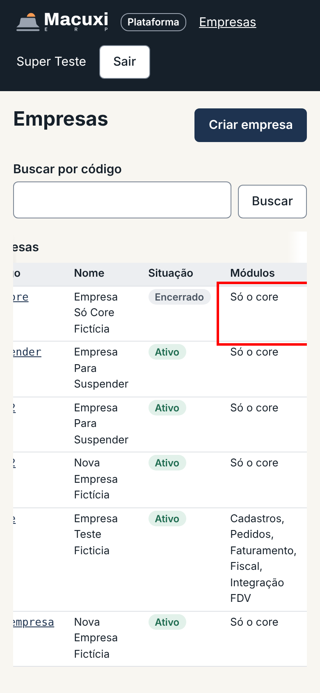

| RD | Texto atual | Ação | Proposta |
|---|---|---|---|
| 1049 | "Só o core" (coluna Módulos) | trocar | "—" |

### Empresa recém-criada
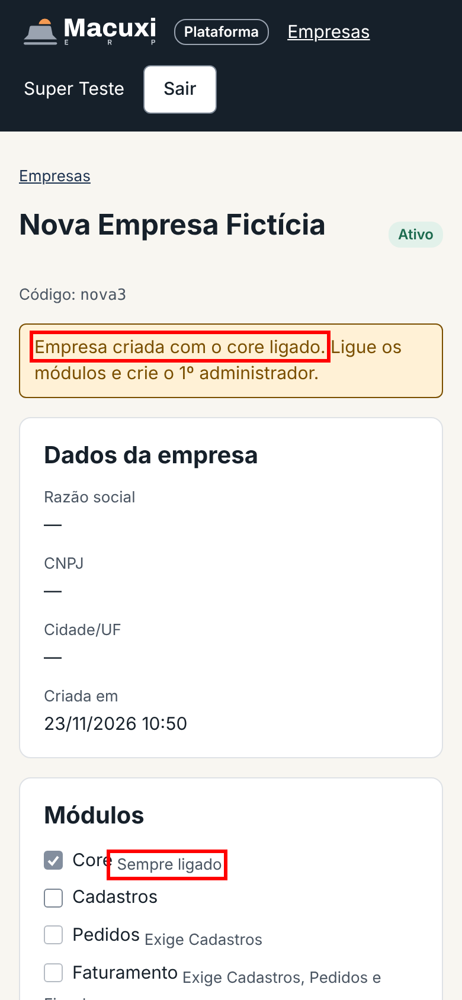

| RD | Texto atual | Ação | Proposta |
|---|---|---|---|
| 1048 | linha "Core" travada + "Sempre ligado" | remover | sai a linha (já no PR da v0.3.2) |
| 1050 | "Empresa criada com o core ligado. Ligue os módulos e crie o 1º administrador." | trocar | "Empresa criada. Ligue os módulos e crie o 1º administrador." |

### Diálogo Suspender
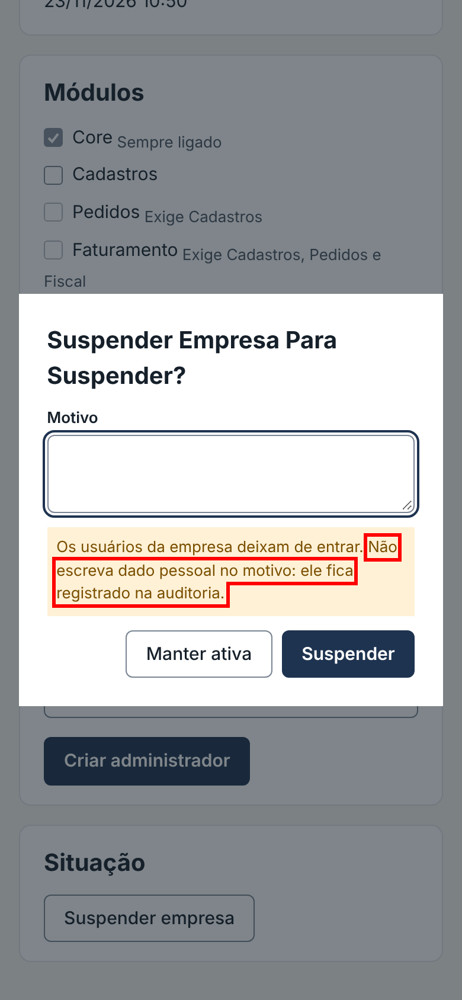

| RD | Texto atual | Ação | Proposta |
|---|---|---|---|
| 1052 | "Não escreva dado pessoal no motivo: ele fica registrado na auditoria." | trocar | "Não escreva dado pessoal no motivo." |

### Diálogo Redefinir senha
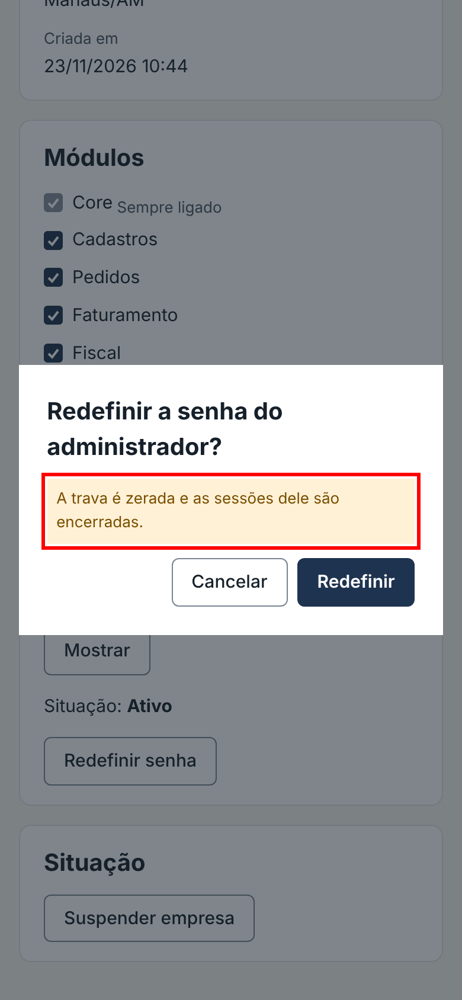

| RD | Texto atual | Ação | Proposta |
|---|---|---|---|
| 1051 | "A trava é zerada e as sessões dele são encerradas." | trocar | "A senha atual deixa de valer, e ele precisa entrar de novo com a senha nova." (já no PR da v0.3.2) |

### Empresa encerrada
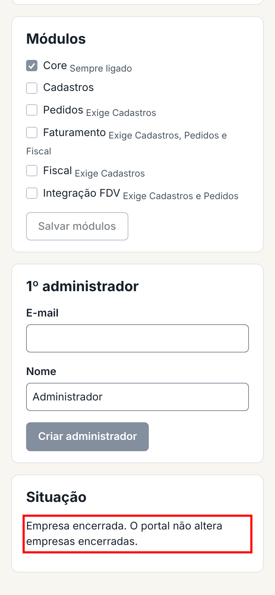

| RD | Texto atual | Ação | Proposta |
|---|---|---|---|
| 1053 | "Empresa encerrada. O portal não altera empresas encerradas." | trocar | "Empresa encerrada." |

## Shell do BKO

### Início
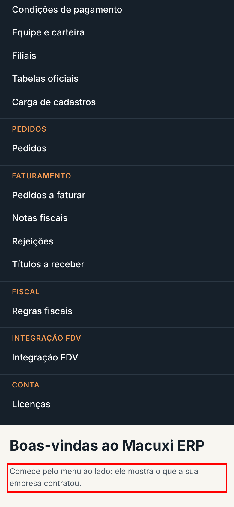

| RD | Texto atual | Ação | Proposta |
|---|---|---|---|
| 1057 | "Comece pelo menu ao lado: ele mostra o que a sua empresa contratou." | trocar | "Comece pelo menu ao lado." |

### Tela sem conteúdo
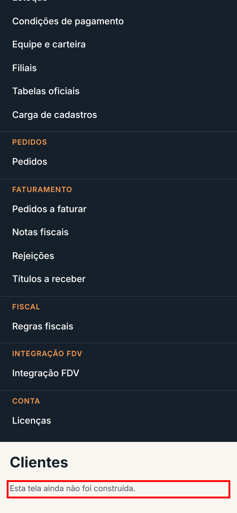

| RD | Texto atual | Ação | Proposta |
|---|---|---|---|
| 1056 | "Esta tela ainda não foi construída." | trocar | "Disponível em breve." |

### Lista com horário (a nota de fuso)
Aparece nas telas de Faturamento abaixo (prints 10 e 11).

| RD | Texto atual | Ação | Proposta |
|---|---|---|---|
| 1062 | "Horários no fuso da empresa." | remover | — |

## Carga de cadastros
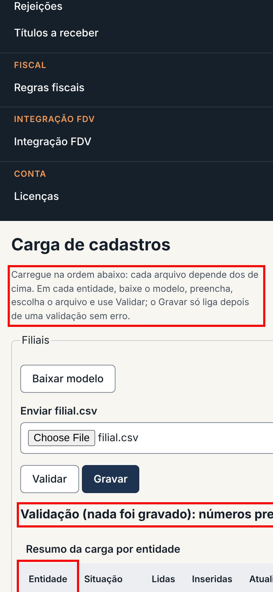

| RD | Texto atual | Ação | Proposta |
|---|---|---|---|
| 1063 | "Carregue na ordem abaixo: cada arquivo depende dos de cima. Em cada entidade, baixe o modelo, preencha, escolha o arquivo e use Validar; o Gravar só liga depois de uma validação sem erro." | trocar | "Carregue na ordem abaixo. Em cada cadastro: baixe o modelo, preencha, escolha o arquivo, valide e grave." |
| 1064 | coluna "Entidade" | trocar | "Cadastro" |
| 1066 | "Validação (nada foi gravado): números previstos" | trocar | "Validação: números previstos" |

Observação de layout (fora da A0): neste tamanho a tabela de resultado passa da largura da tela.

## Integração FDV
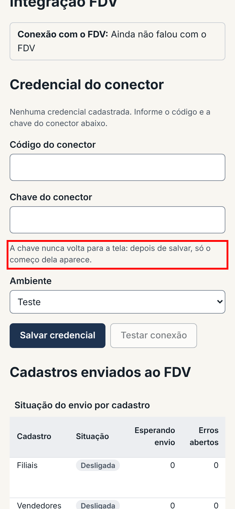

| RD | Texto atual | Ação | Proposta |
|---|---|---|---|
| 1071 | "A chave nunca volta para a tela: depois de salvar, só o começo dela aparece." | remover | — |

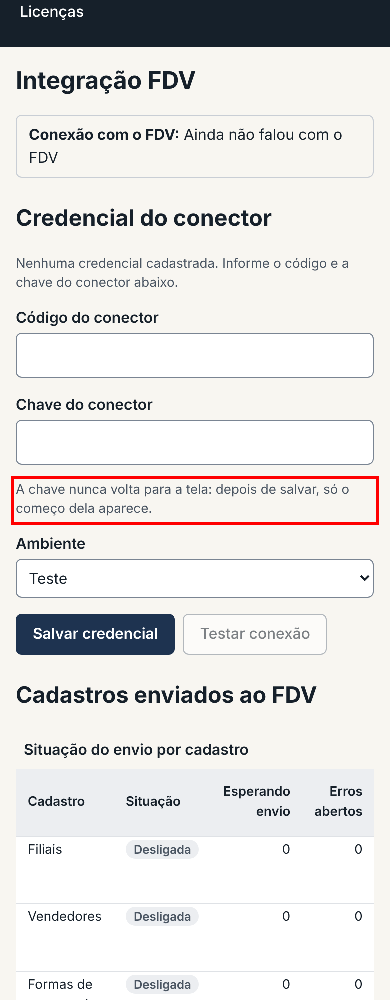

| RD | Texto atual | Ação | Proposta |
|---|---|---|---|
| 1072 | "Registros que não foram ao FDV porque a chave mudou ou está repetida. Corrija no cadastro de origem." | trocar | "Corrija a chave no cadastro de origem." |
| 1073 | "Ver os envios (lotes)" | trocar | "Ver os envios" |

## Faturamento
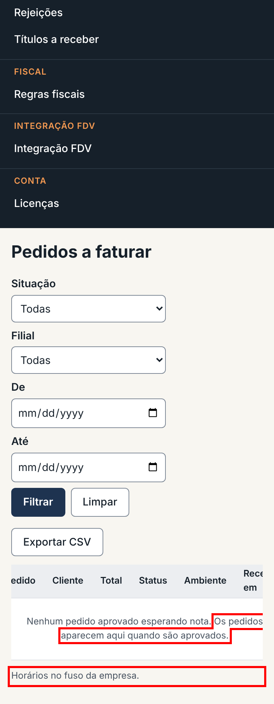

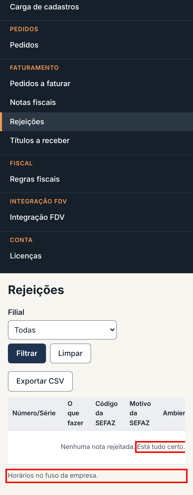

| RD | Texto atual | Ação | Proposta |
|---|---|---|---|
| 1076 | 2ª frase das listas vazias ('Os pedidos aparecem aqui quando são aprovados.', 'Está tudo certo.') | trocar | só a 1ª frase |

## Core
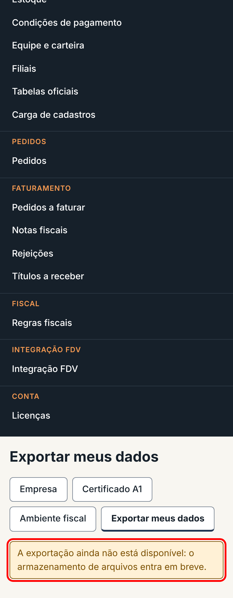

| RD | Texto atual | Ação | Proposta |
|---|---|---|---|
| 1078 | "A exportação ainda não está disponível: o armazenamento de arquivos entra em breve." | trocar | "Exportação disponível em breve." |

## Sem print
Estado de erro, condição rara ou tela que o ambiente local não monta. O texto atual, o que muda e a proposta são os da varredura.

| RD | Motivo | Texto em | Proposta |
|---|---|---|---|
| 1054 | sessão expirada do portal | `apps/web/src/lib/config/erros.ts:47` | "Seu acesso expirou. Entre de novo." |
| 1055 | sessão expirada | `apps/web/src/lib/descritor/escrita.ts:42` e `apps/web/src/lib/textos.ts:4` | "Seu acesso expirou. Entre de novo." |
| 1058 | erro de rede da API | `apps/web/src/app/(shell)/[modulo]/[...pagina]/acoes.ts:36` e `apps/web/src/app/envio-carga/route.ts:59` | "Sem resposta do servidor. Tente de novo em instantes." |
| 1059 | resposta fora do contrato | `apps/web/src/components/descritor/acoes-detalhe.tsx:61` e `apps/web/src/lib/api.ts:199` | "Não foi possível concluir agora. Tente de novo em instantes." |
| 1060 | API não configurada | `apps/web/src/app/(shell)/[modulo]/[...pagina]/acoes-integracao-fdv.ts:48` e `apps/web/src/lib/api.ts:190` | "Indisponível agora. Fale com a Macuxi." |
| 1061 | recusa de regra (422) | `apps/web/src/lib/descritor/escrita.ts:49` | "Não foi possível concluir. Confira os dados e tente de novo." |
| 1065 | carga que estourou o tempo | `apps/web/src/lib/textos.ts:6` | "A carga passou do tempo. Divida o arquivo em partes menores e envie de novo." |
| 1067 | caixa de confirmação do navegador (não sai em print) | `modules/cadastros/web/carga.ts:53` | "Gravar N arquivos nos cadastros? Valide antes para conferir." |
| 1068 | só no envio de vários arquivos, que esta tela não usa | `modules/cadastros/web/carga.ts:66` | "O envio passa de X MB: mande poucos arquivos por vez." |
| 1069 | exige um arquivo de cadastro fora da v1 | `modules/cadastros/web/carga.ts:37` | "Ignorado" |
| 1070 | só aparece com o FDV parado por versão | `apps/web/src/components/integracao-fdv/vista.tsx:67` | "Versão do FDV não aceita. Atualize o Macuxi FDV." |
| 1074 | caixa de confirmação do navegador | `modules/integracao-fdv/web/monitor.ts:73` | "Enviar X ao FDV de novo, tudo de uma vez? Pode demorar." |
| 1075 | exige nota autorizada com XML ainda por guardar | `apps/web/src/lib/telas/faturamento.ts:282` | "Autorizada pela SEFAZ. Aguarde alguns instantes para seguir." |
| 1077 | exige filial em contingência | `modules/faturamento/web/contingencia.ts:87` | "As próximas notas voltam a sair normalmente." |
| 1079 | a tela Ambiente fiscal aparece como "não construída" no ambiente local | `modules/core/web/paginas.ts:25` | "Para emitir em produção, fale com a Macuxi." |
| 1080 | as telas de cadastros aparecem como "não construídas" no ambiente local | `modules/cadastros/web/paginas.ts:39`, `:59`, `:69` | "Contribuinte ICMS", "Forma de pagamento", "Regime tributário" |

## Mantidos de propósito
Aviso de que a senha provisória não volta a aparecer; avisos de consequência em emitir, cancelar, estornar e trocar chave de integração; mensagens de erro que já dizem o que fazer.

## Para o Alexandre
Responda com uma linha: **"Aprovo todos"** ou **"Aprovo exceto RD-…"**.
